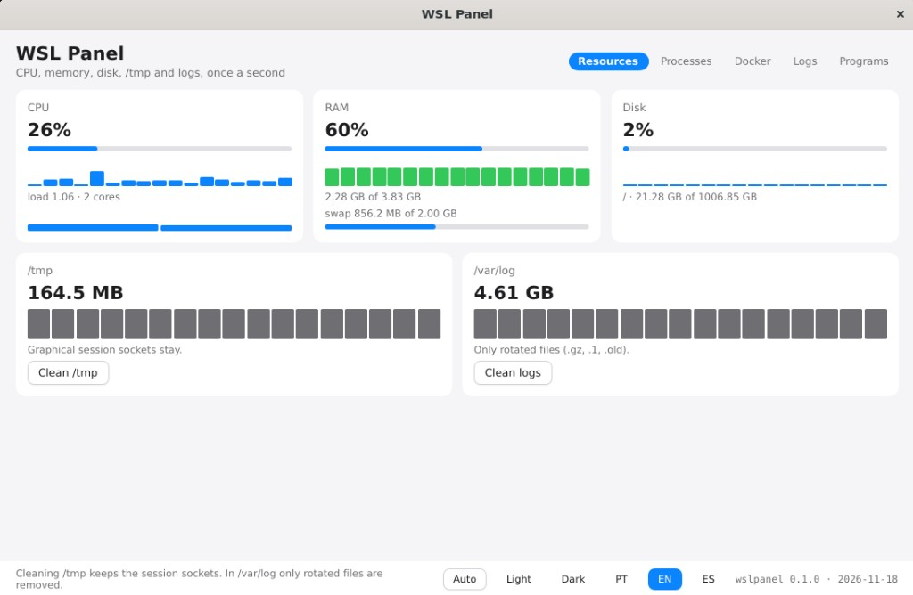

# wslpanel

[Português](README.md) · [English](README-EN.md)

Panel de la distro WSL: consumo de CPU, memoria, disco, `/tmp` y `/var/log`, una vez por segundo, y los programas instalados por dpkg. La versión **0.1.0** (2026-11-18) aparece en el pie.

Repositorio: <https://github.com/araguaci/wslpanel>



## Recursos

- **Recursos** (página inicial): porcentaje de CPU, carga, una barra por núcleo, RAM, swap, disco de `/`, tamaño de `/tmp` y de `/var/log`, con el historial reciente.
- **Limpiar /tmp**: pide confirmación y borra archivos y carpetas comunes. Se quedan los sockets de la sesión gráfica: `.X11-unix`, `.ICE-unix`, `.XIM-unix` y `.font-unix`.
- **Limpiar logs**: pide confirmación y solo quita archivos ya rotados (`.gz`, `.xz`, `.bz2`, `.old` o nombre terminado en `.<número>`, como `syslog.1`). El log activo permanece. Sin permiso, el panel avisa y no pide contraseña.
- **Procesos**: nombre, PID, parte de CPU, RSS y estado, leídos de `/proc`. Terminar envía SIGTERM, con confirmación. El proceso 1 y este panel se quedan.
- **Docker**: la pestaña solo aparece si el cliente `docker` está instalado. Muestra cada contenedor en ejecución, con CPU y memoria leídas del cgroup, PIDs y el estado de `docker ps`.
- **Logs**: el final de los archivos de texto en `/var/log` (también un nivel más abajo, como `apt/history.log`). El número de líneas empieza en 50 y sube de 50 en 50, hasta 2000. Los archivos comprimidos y los binarios `wtmp`, `btmp`, `lastlog` y `faillog` quedan fuera.
- **Programas**: paquetes de esta distro Debian/Ubuntu. Búsqueda, filtros (programas, manuales, todos, actualizaciones, huérfanos, bibliotecas) y orden por nombre, tamaño o fecha. El detalle muestra versión, origen, tamaño, dependencias y quién exige el paquete.
- Actualizar, quitar y limpiar huérfanos piden confirmación en un diálogo y ejecutan `sudo -n apt-get`. La contraseña no se guarda: si sudo la pide, el comando aparece en el pie, con **Copiar**. Un paquete esencial o de prioridad obligatoria no se quita.
- **Tema**: Auto sigue el sistema. Claro y Oscuro están en el pie, junto a PT, EN y ES.
- **Idiomas**: portugués (pt_BR), inglés y español. El idioma sigue `WSLPANEL_LANG`, luego `LC_ALL`, `LC_MESSAGES` y `LANG`. Si no hay nada de eso, la interfaz abre en portugués. Los botones PT, EN y ES del pie valen para la sesión.
- El pie muestra `wslpanel`, la versión de `build.zig.zon` y la fecha de la release.

Lo que ya entró y lo que viene después está en [docs/PLANO.md](docs/PLANO.md).

## Requisitos

- Linux, incluida una distro Debian o Ubuntu en WSL2. La pestaña Programas lee `/var/lib/dpkg/status`.
- [Zig 0.17.0](https://ziglang.org/download/0.17.0/).
- GTK 3 (`libgtk-3-0`) para la ventana. En WSL2, WSLg deja `DISPLAY` definido.
- `sudo` para las acciones de paquetes. La limpieza de `/tmp` y `/var/log` usa los permisos del usuario.

## Instalar y ejecutar

```sh
git clone https://github.com/araguaci/wslpanel
cd wslpanel
zig build -Doptimize=ReleaseSafe
./zig-out/bin/wslpanel
```

La primera compilación descarga [nanoui](https://github.com/justrach/nanoui) (MIT, Rach Pradhan), en la revisión fijada en `build.zig.zon`.

En Debian o Ubuntu:

```sh
sudo apt-get update
sudo apt-get install -y libgtk-3-0
```

Zig 0.17.0, si todavía no está en el `PATH`:

```sh
# https://ziglang.org/download/0.17.0/zig-x86_64-linux-0.17.0.tar.xz
tar -xJf zig-x86_64-linux-0.17.0.tar.xz -C "$HOME/.local"
export PATH="$HOME/.local/zig-x86_64-linux-0.17.0:$PATH"
```

Otro idioma en esta ejecución:

```sh
WSLPANEL_LANG=en ./zig-out/bin/wslpanel
WSLPANEL_LANG=es ./zig-out/bin/wslpanel
WSLPANEL_LANG=pt_BR ./zig-out/bin/wslpanel
```

## Desarrollo

```sh
zig build test
zig build
./zig-out/bin/wslpanel --nanoui-snapshot=/tmp/wslpanel.png --nanoui-wait=2
```

`--nanoui-wait=2` deja que el medidor lea un segundo de delta de `/proc/stat` antes de la captura. No se muestra ninguna ventana.

La versión publicada es la de `build.zig.zon`. La fecha del pie está en `src/meta.zig`. El historial está en [CHANGELOG.md](CHANGELOG.md). Los pasos de versión, changelog y release están en [docs/RELEASE.md](docs/RELEASE.md).

## Licencia

MIT. Vea [LICENSE](LICENSE). La interfaz se dibuja con nanoui, que tiene su propia licencia MIT.
