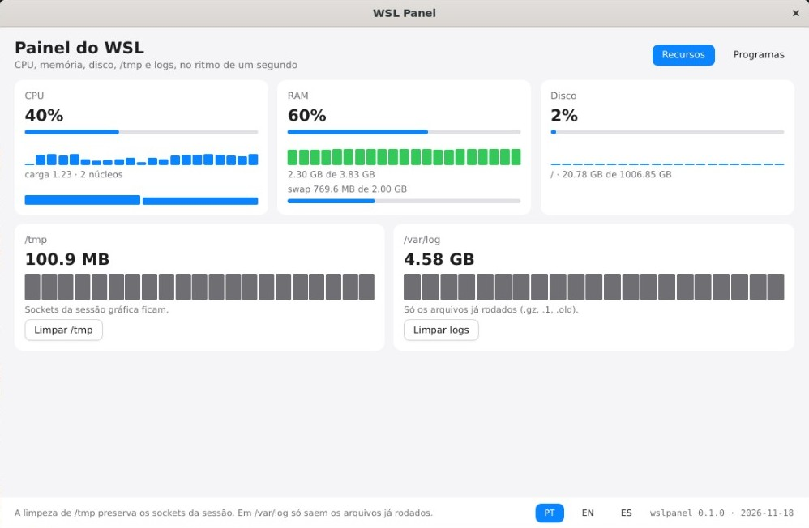

# 4,58 GB em /var/log. O painel da distro WSL mostra isso na primeira tela.

Capa do artigo (2000×800): [x-cover.jpg](x-cover.jpg)

A distro WSL fica quieta até o disco encher. CPU, RAM, `/tmp` e `/var/log` só aparecem se você abrir um `htop` e um `du`.

O **wslpanel** põe isso na primeira tela. A segunda aba é a lista de programas instalados pelo dpkg.

## O que a primeira tela mede

A página **Recursos** atualiza no ritmo de um segundo.

- **CPU**, com a carga e uma barra por núcleo
- **RAM** e swap
- **Disco** de `/`
- Tamanho de **`/tmp`** e de **`/var/log`**, com o histórico recente

Na captura desta máquina: 40% de CPU em 2 núcleos, carga 1,23, 2,30 GB de 3,83 GB de RAM, `/tmp` com 100,9 MB e **`/var/log` com 4,58 GB**.

## Dá para limpar sem derrubar a sessão

**Limpar /tmp** pede confirmação. Arquivos e pastas comuns saem. Os sockets da sessão gráfica ficam: `.X11-unix`, `.ICE-unix`, `.XIM-unix` e `.font-unix`.

**Limpar logs** também pede confirmação e só apaga arquivo já rodado: `.gz`, `.xz`, `.bz2`, `.old`, ou um nome que termina em número, como `syslog.1`. O log ativo permanece.

Se faltar permissão, o painel avisa. Essa limpeza usa a sua conta e guarda nenhuma senha.

## A aba Programas é o dpkg, com filtro

Busca, manuais, atualizações, órfãos e bibliotecas. O detalhe mostra versão, origem, tamanho e quem exige o pacote.

Atualizar e remover pedem confirmação e rodam `sudo`. A senha fica no terminal: se o sudo pedir, o comando aparece no rodapé. Pacote essencial, ou de prioridade obrigatória, permanece.

## Português, inglês e espanhol

O idioma segue `WSLPANEL_LANG`, depois o locale do sistema. Os botões **PT**, **EN** e **ES** valem para a sessão.

O rodapé mostra a versão e a data: **wslpanel 0.1.0 · 2026-11-18**.

## Abrir

A release traz o binário Linux x86_64. Para compilar, Zig 0.17. A janela precisa de GTK 3.

Repositório: https://github.com/araguaci/wslpanel

Release: https://github.com/araguaci/wslpanel/releases/tag/v0.1.0

Se o `/var/log` da sua distro também passou dos gigabytes, o tamanho está na primeira tela.
